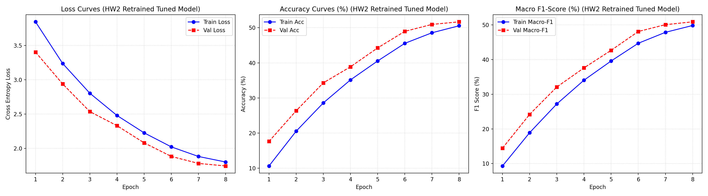
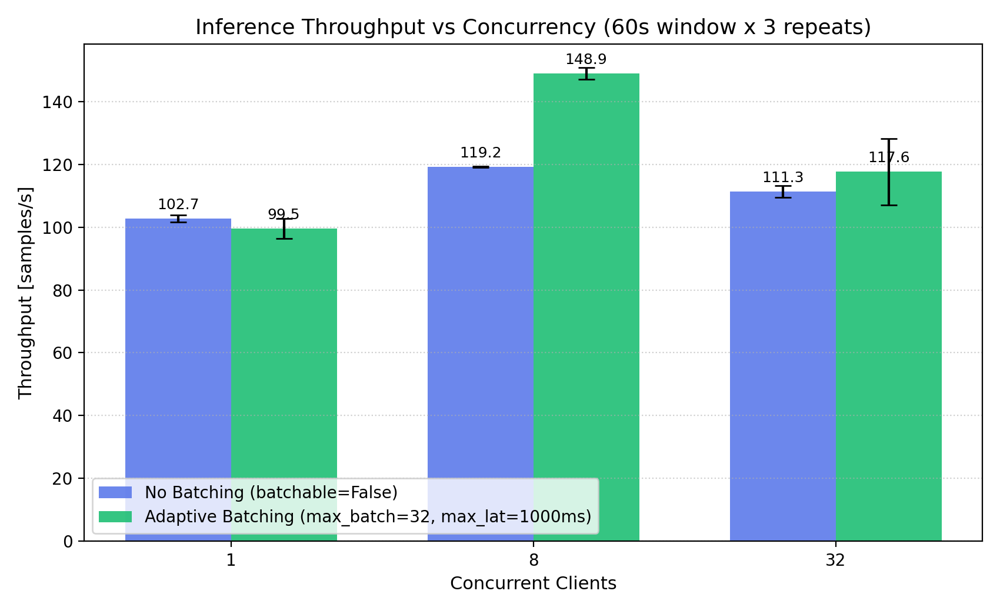
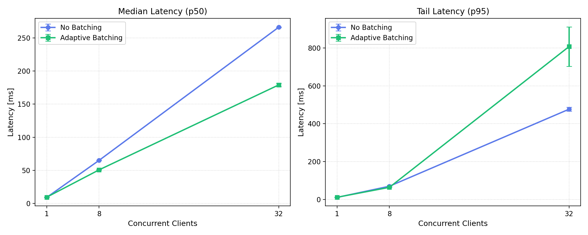
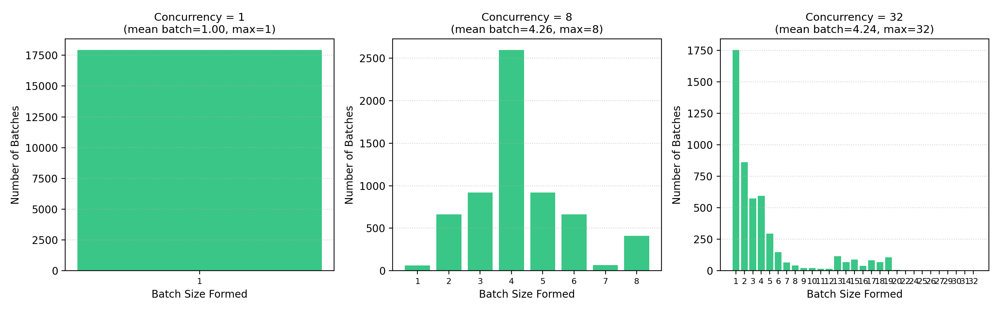

# MLOps Homework 2: Model Serving & Dynamic Batching Benchmark (BentoML)

This directory implements **Homework 2** (`HOMEWORK2.md`): retraining the tuned CIFAR-100 Residual CNN from Homework 1 using its preserved Optuna hyperparameters, exporting and packaging it for inference, serving it as a REST API with **BentoML**, and benchmarking **no batching** vs. **adaptive dynamic batching** under a fixed 60-second window across concurrency levels `1`, `8`, and `32` (3 repeats each).

---

## Acceptance Criteria Checklist

| Criterion | Implementation & Verification | Status |
|---|---|---|
| **Retrained HW1 Model** | Retrained `CIFAR100ResNet` (`CIFAR100LightningModule`) with HW1 Optuna best parameters (`hpo_summary.json`) via [`train_and_export.py`](train_and_export.py) | **PASS** |
| **Model Export & Packaging** | Saved Lightning `.ckpt`, `state_dict`, verified TorchScript `.pt` (`0.0` max diff across batch sizes `1, 8, 32`), BentoML store tag `cifar100_resnet:t64liwhdtowdhrk7`, and [`bentofile.yaml`](bentofile.yaml) | **PASS** |
| **Model-Serving Code & Commands** | [`service.py`](service.py) defines `CIFAR100ServiceNoBatch` (`batchable=False`) and `CIFAR100ServiceAdaptiveBatch` (`batchable=True, batch_dim=0, max_batch_size=32, max_latency_ms=1000`) | **PASS** |
| **Client Request Example & Working Output** | Verified [`client_example.py`](client_example.py) and `curl` against `POST /predict`, returning valid CIFAR-100 class probabilities | **PASS** |
| **Dynamic Batching Benchmark** | [`benchmark.py`](benchmark.py) ran 10s warm-up + 60s window × 3 repeats at concurrency `1, 8, 32`; results in [`benchmark_results.json`](benchmark_results.json) and `plots/` | **PASS** |

---

## 1. Model Retraining & Export (from Homework 1)

The original Homework 1 checkpoint was missing, while the Optuna study result remained in [`../../homework1/156042_156053/hpo_summary.json`](../../homework1/156042_156053/hpo_summary.json):

```json
{
  "lr": 0.0016834549246003507,
  "optimizer_name": "adamw",
  "weight_decay": 0.00041282053438262235,
  "dropout_rate": 0.09680559213273096,
  "batch_size": 64
}
```

### Retraining Command
```bash
python train_and_export.py --epochs 8 --seed 42 --num-workers 4
```

### Retraining Metrics (`CIFAR100ResNet`, 2.5 M parameters, 8 epochs on CPU)
| Metric | Value |
|---|---|
| Training Time | 3,295.10 s (54.92 min) |
| Best Validation Accuracy | **51.67%** |
| Best Validation Macro-F1 | **50.90%** |
| Test Accuracy | **53.47%** |
| Test Macro-F1 | **52.65%** |
| Test Cross-Entropy Loss | **1.7026** |



### Exported Model Artifacts
- PyTorch Lightning checkpoint: [`models/best_tuned_model.ckpt`](models/best_tuned_model.ckpt) (also copied to [`../../homework1/156042_156053/checkpoints/best_tuned_model.ckpt`](../../homework1/156042_156053/checkpoints/best_tuned_model.ckpt))
- PyTorch weights + metadata: [`models/cifar100_resnet_state.pt`](models/cifar100_resnet_state.pt) & [`models/model_metadata.json`](models/model_metadata.json)
- TorchScript traced model: [`models/cifar100_resnet_scripted.pt`](models/cifar100_resnet_scripted.pt) (numerically verified against eager PyTorch: max abs diff `0.0` at batch sizes `1`, `8`, and `32`)
- BentoML local model store entry: `cifar100_resnet:t64liwhdtowdhrk7`

---

## 2. BentoML Service Configuration & Startup Commands

Both services in [`service.py`](service.py) share the exact same `_CIFAR100InferenceEngine` (`torch.jit.optimize_for_inference`, `TORCH_NUM_THREADS=4`, `workers=1`, `torch.inference_mode()`), ensuring an apples-to-apples comparison:

1. **No Batching (`CIFAR100ServiceNoBatch`)**:
   - `@bentoml.api(batchable=False)` — processes each incoming request individually.
2. **Adaptive Dynamic Batching (`CIFAR100ServiceAdaptiveBatch`)**:
   - `@bentoml.api(batchable=True, batch_dim=0, max_batch_size=32, max_latency_ms=1000)` — uses BentoML's `CorkDispatcher` adaptive batcher to group concurrent `(1, 3, 32, 32)` tensors along `batch_dim=0` up to `32` samples per forward pass.
   - Exposes `/metadata`, `/batch_stats`, and `/reset_stats` endpoints to inspect the exact batch size histogram formed by the server.

### Start Commands
```bash
# 1. Start service WITHOUT dynamic batching
BENTOML_HOME=./.bentoml bentoml serve service:CIFAR100ServiceNoBatch --port 3000 --host 127.0.0.1

# 2. Start service WITH adaptive dynamic batching
BENTOML_HOME=./.bentoml BENTO_MAX_BATCH_SIZE=32 BENTO_MAX_LATENCY_MS=1000 \
  bentoml serve service:CIFAR100ServiceAdaptiveBatch --port 3000 --host 127.0.0.1
```

Optional Bento build command using [`bentofile.yaml`](bentofile.yaml):
```bash
BENTOML_HOME=./.bentoml bentoml build
```

---

## 3. Client Request Example & Working Output

### Python Client (`requests`)
```bash
python client_example.py --url http://127.0.0.1:3000 --sample-idx 7
```

Observed output against the trained model:
```text
Service URL      : http://127.0.0.1:3000
Batching Mode    : adaptive
Input Shape      : [1, 3, 32, 32]
Saved cURL JSON  : /home/patryk/Desktop/masters/mlops/homework2/156042_156053/sample_request.json
Sample Index     : 7
Ground Truth     : [14] butterfly
Top-1 Prediction : [7] beetle (33.88%)
Round-trip Time  : 23.09 ms

Top-5 Predictions:
  1. [ 7] beetle               :  33.88%
  2. [74] shrew                :   8.85%
  3. [21] chimpanzee           :   6.83%
  4. [14] butterfly            :   3.80%
  5. [78] snake                :   3.56%
```

### cURL Example
[`client_example.py`](client_example.py) writes the normalized tensor payload to `sample_request.json` so it can be queried directly via `curl`:
```bash
curl -s -X POST http://127.0.0.1:3000/predict \
  -H "Content-Type: application/json" \
  -d @sample_request.json
```

Observed output (truncated prefix of the `(1, 100)` softmax probability array, total 2,277 chars):
```json
[[7.844062565709464e-06, 1.601463372935541e-05, 0.0011225850321352482, 0.019634200260043144, 0.03460981324315071, 3.6376559364725836e-06, 0.008431012742221355, 0.3387528657913208, ...]]
```

---

## 4. Dynamic Batching Benchmark

### Fixed Conditions & Methodology
- **Hardware**: `Intel(R) Core(TM) i5-8265U CPU @ 1.60GHz` (4 physical cores / 8 logical threads, CPU-only, no NVIDIA GPU)
- **Software**: Linux `7.2.10-arch1-1-x86_64`, Python `3.10.18`, PyTorch `2.14.1+cpu`, BentoML `1.4.40`
- **Service Settings**: `workers=1`, `TORCH_NUM_THREADS=4`, TorchScript (`optimize_for_inference`)
- **Batching Parameters**: `max_batch_size=32`, `max_latency_ms=1000`, `batch_dim=0`
- **Payload**: Fixed normalized CIFAR-100 image `(1, 3, 32, 32)` serialized once (`63,863` JSON bytes per request = 1 sample)
- **Load Generator**: `asyncio` + `httpx.AsyncClient` in [`benchmark.py`](benchmark.py)
- **Protocol**: `10 s` warm-up discarded before each concurrency level (`1`, `8`, `32`), followed by `3 × 60 s` fixed-window measurements per configuration (`mean ± std` reported).

### Command Used
```bash
python benchmark.py --concurrencies 1 8 32 --warmup 10 --duration 60 --repeats 3 --max-batch-size 32 --max-latency-ms 1000
```

### Required Results Table

| Concurrency | Throughput no batching [samples/s] | Throughput with batching [samples/s] | p95 latency no batching [ms] | p95 latency with batching [ms] |
|---|---|---|---|---|
| 1 | 102.74 ± 1.13 | 99.55 ± 3.23 | 11.38 ± 0.28 | 11.96 ± 0.80 |
| 8 | 119.18 ± 0.23 | 148.94 ± 1.82 | 70.33 ± 0.79 | 64.47 ± 1.32 |
| 32 | 111.35 ± 1.82 | 117.58 ± 10.59 | 476.58 ± 10.50 | 806.99 ± 104.30 |

### Full Latency & Batch Formation Breakdown

| Mode | Concurrency | Throughput [samples/s] | p50 [ms] | p95 [ms] | p99 [ms] | Mean Batch Size | Max Batch Observed | Total Samples (3×60s) | Errors |
|---|---|---:|---:|---:|---:|---:|---:|---:|---:|
| No Batch | 1 | 102.74 ± 1.13 | 9.22 ± 0.06 | 11.38 ± 0.28 | 13.35 ± 0.72 | 1.00 | 1 | 18,495 | 0 |
| Adaptive | 1 | 99.55 ± 3.23 | 9.56 ± 0.12 | 11.96 ± 0.80 | 13.86 ± 1.51 | 1.00 | 1 | 17,920 | 0 |
| No Batch | 8 | 119.18 ± 0.23 | 65.17 ± 0.32 | 70.33 ± 0.79 | 97.93 ± 16.61 | 1.00 | 1 | 21,475 | 0 |
| Adaptive | 8 | **148.94 ± 1.82** | **50.83 ± 0.58** | **64.47 ± 1.32** | **79.11 ± 8.61** | **4.26** | 8 | 26,828 | 0 |
| No Batch | 32 | 111.35 ± 1.82 | 266.15 ± 0.59 | 476.58 ± 10.50 | 851.53 ± 102.73 | 1.00 | 1 | 20,126 | 1 |
| Adaptive | 32 | **117.58 ± 10.59** | **179.03 ± 2.51** | 806.99 ± 104.30 | 1404.39 ± 110.76 | 4.24 | 32 | 21,231 | 0 |

### Visualizations

| Throughput vs. Concurrency | Latency (p50 & p95) vs. Concurrency |
|---|---|
|  |  |



---

## 5. Results Analysis & Lessons Learned

1. **Concurrency = 1 (Sanity Check)**:
   - Throughput is virtually identical (`102.74` vs. `99.55 samples/s`), and every request executes as batch size `1`. The ~0.3 ms difference in median latency (`9.22 -> 9.56 ms`) comes from BentoML's `CorkDispatcher` async queue and future scheduling overhead.

2. **Concurrency = 8 (Best Operating Point — +25.0% Throughput & Lower Latency)**:
   - Adaptive batching increases throughput from `119.18` to `148.94 samples/s` (**+25.0%**) while **simultaneously reducing latency across all percentiles**: p50 drops by **22.0%** (`65.17 -> 50.83 ms`), p95 drops by **8.3%** (`70.33 -> 64.47 ms`), and p99 drops by **19.2%** (`97.93 -> 79.11 ms`).
   - Standalone CPU TorchScript inference scales well with batching (`6.22 ms` for `B=1` -> `27.46 ms` for `B=8`, i.e. `160.7 -> 291.4 samples/s`), so coalescing ~4.26 requests per batch amortizes both PyTorch/oneDNN dispatch overhead and Python runner calls.

3. **Concurrency = 32 (CPU Saturation & JSON Parsing Bottleneck)**:
   - Median latency improves substantially (`266.15 -> 179.03 ms`, **-32.7%**), and repeat 2 reached `129.70 samples/s` (`mean_batch=7.82`), yielding a modest average throughput gain (`111.35 -> 117.58 samples/s`, **+5.6%**).
   - However, tail latency degrades (`p95: 476.58 -> 806.99 ms`) and throughput fluctuates (`std = 10.59 samples/s`). Inspecting `plots/batch_size_distribution.png` explains why: at `C=32`, batch sizes are bimodal (`1–5` and `13–19`). Because each request transmits `63,863` bytes of JSON text floats, deserializing 32 concurrent JSON payloads on the single Python event loop competes with the 4 PyTorch C++ inference threads, creating bursty arrivals and occasional large queued batches (`max=32`) whose queuing delay inflates p95/p99.

4. **Important BentoML `CorkDispatcher` Insight (`max_latency_ms` Semantics)**:
   - In BentoML (`bentoml/_internal/marshal/dispatcher.py`), `max_latency_ms` is **not** a passive batching queue wait timeout (like Triton's `max_queue_delay_microseconds`); it is a **total latency SLA** (`queue_wait_w0 + o_a * n + o_b`). When estimated latency exceeds `max_latency_ms`, `CorkDispatcher` actively sheds load by cancelling queued futures with HTTP `503 ServiceUnavailable`.
   - In an initial smoke test with `max_latency_ms=50`, concurrency 8 suffered `204` HTTP 503 drops because `B=8` CPU execution + queuing exceeded `50 ms` (and `B=32` forward pass alone takes ~`86.4 ms`). Raising `max_latency_ms=1000` eliminated all 503 rejections (`0` errors across all `65,979` adaptive-batching requests) while allowing BentoML's online linear cost estimator to dynamically adjust batch release times.

---

## Repository Structure

```text
homework2/156042_156053/
├── README.md
├── requirements.txt
├── bentofile.yaml
├── service.py                        # CIFAR100ServiceNoBatch & CIFAR100ServiceAdaptiveBatch
├── train_and_export.py               # Retrain from HW1 hpo_summary.json & export checkpoints/TorchScript
├── client_example.py                 # Python requests client & sample_request.json generator
├── benchmark.py                      # 60s x 3 repeats async load tester & plot generator
├── benchmark_results.json            # Raw and aggregated benchmark metrics
├── src/                              # Model, Dataset, DataModule, and utils from HW1
├── models/
│   ├── best_tuned_model.ckpt         # Lightning checkpoint (also copied to HW1 checkpoints/)
│   ├── cifar100_resnet_state.pt      # Pure PyTorch state_dict + metadata
│   ├── cifar100_resnet_scripted.pt   # Verified TorchScript artifact
│   └── model_metadata.json
└── plots/
    ├── retrained_model_curves.png
    ├── throughput_vs_concurrency.png
    ├── latency_vs_concurrency.png
    └── batch_size_distribution.png
```
